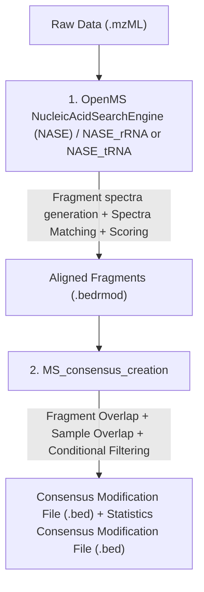

# MS-seq Analysis

This directory contains the pipeline modules used to process MS-seq data and identify post-transcriptional RNA modifications across the RNA biotypes rRNA and tRNA. In contrast to the other methods MS-seq technology was not used to analyze poly(A) RNA sequences. With the current technology, the analyzed fragments are too small to align them truthfully to big references, like the whole human transcriptome.

The pipeline is organized into two distinct layers, the Open-MS spectra to sequence mapping and the Consensus creation pipeline, combining aligned fragments and different samples to a consensus modification map.

---

## Overall Pipeline Architecture

The workflow progresses through the folders in this directory as follows:



---


## Directory Overview

The folder is divided into five main components:

### 1. [`NASE_rRNA/`](NASE_rRNA/) (rRNA-pipeline)
- **Purpose:** rRNA specific generation of digested fragments and their spectra, matching of these spectra with the sample, scoring of the results 
- **Key Features:**
    - Pipeline execution script (see details in [README.md](NASE_rRNA/README.md)).
    - Pipeline Specifications for generation of decoy database and general workflow

### 2. [`NASE_tRNA/`](NASE_tRNA/) (tRNA-pipeline)
- **Purpose:** tRNA specific generation of digested fragments and their spectra, matching of these spectra with the sample, scoring of the results 
- **Key Features:**
    - Pipeline execution script (see details in [README.md](NASE_rRNA/README.md)).
    - Pipeline Specifications for generation of decoy database and general workflow


### 3. [`MS-seq Consensus creation/`](MS_consensus_creation/) (Sample Merging/Filtering pipeline)
- **Purpose:** Filtering and merging of different aligned fragment files to a consensus modification map.
- **Key Features:**
  - Consensus_creation_main python script. Initiates the pipeline (see details in [README.md](MS_consensus_creation/README.md)).

### 4. [`Docker/`](docker/)
- **Purpose:** Provides a docker entry point bash script to utilize the Docker image and MS-seq functions.

### 5. [`OpenMS/`](OpenMS/) (Main MS software bundle)
- **Purpose:** Links to the OpenMS github page. Further Details for developers and scientists to adapt our pipeline and use additional tools.

---

## Getting Started

1. **Pull the validated MS-seq image**

The versioned image bundles the OpenMS executables, rRNA and tRNA search settings, and all three pipeline scripts. Its short Kaiser rRNA and tRNA bedRMod outputs were byte-identical to the stage 8 references with 28 search threads. The published image is for Linux/amd64. If the GitHub package is private, authenticate to GHCR before pulling it.

```bash
HRP_MS_SEQ_IMAGE=ghcr.io/human-rnome-project/hrp-ms-seq:legacy-export-0bd0798-857ad796@sha256:a8ade7b56ec5c2680a6b4aa556f9ee9c446487ba4666586bfe15d8dbbe6e1e88
docker pull "$HRP_MS_SEQ_IMAGE"
```

To rebuild locally instead, use the pinned OpenMS base in the [`Dockerfile`](Dockerfile) and the bundled INIs:

```bash
docker build -t hrp-ms-seq:local .
HRP_MS_SEQ_IMAGE=hrp-ms-seq:local
```

2. **rRNA/tRNA Processing:** Run the command below or follow the detailed instructions in the [`NASE_rRNA/README.md`](NASE_rRNA/README.md) or [`NASE_tRNA/README.md`](NASE_tRNA/README.md) to get the aligned modified fragments.

```bash
docker run --rm -v "$PWD":/data "$HRP_MS_SEQ_IMAGE" rrna \
    /data/sample.mzML /data/ref.fasta \
    --precursor-tolerance <precursor-tolerance> --product-tolerance <product-tolerance> --output-dir /data/results/rRNA

docker run --rm -v "$PWD":/data "$HRP_MS_SEQ_IMAGE" trna \
    /data/sample.mzML /data/ref.fasta \
    --precursor-tolerance <precursor-tolerance> --product-tolerance <product-tolerance> --output-dir /data/results/tRNA
```

3. **Filtering and Consensus Modifications:** Run the command below or follow the detailed instructions in the [`MS_consensus_creation/README.md`](MS_consensus_creation/README.md) to extract your modifications.

```bash
docker run --rm -v "$PWD":/data "$HRP_MS_SEQ_IMAGE" consensus \
    --input-folder /data/samples --out-file /data/consensus.bed
```
5. **Help:**
Run `docker run --rm "$HRP_MS_SEQ_IMAGE" --help` for the full usage message, or pass `bash` as the mode for an interactive shell.


## Paper Data-Availability
All analyzed samples are available under https://rnome.jgi.lbl.gov/mass_spectrometry/. Corresponding refrences are available under "Add link when available". Which reference, percursor/product-tolerance and further adaptations to the .ini files were used, is documented in the metadatasheet under https://rnome.jgi.lbl.gov/metadata.html HRP_C. Our pipeline only supports .mzML files, in case of other formats (e.g. .mzXML) we refer to the msconvert function of proteowizard (conda install bioconda::proteowizard or https://proteowizard.sourceforge.io/ or https://github.com/ProteoWizard/pwiz).
For the MS-seq Analysis following samples were used:

**rRNA**
- HRP_C_001_1
- HRP_C_002_1
- HRP_C_005_4
- HRP_C_006_4
- HRP_C_014_1

**tRNA**
- HRP_C_001_3
- HRP_C_008_4
- HRP_C_015_2
